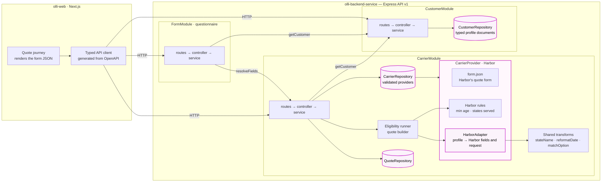
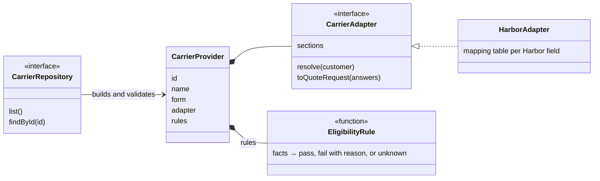

# Olli backend service

Our platform holds one **standard customer profile**. Every insurance carrier sends its quote form as
**JSON** with its own field names, formats, options and rules. This service connects the two; the first
carrier is a fictional one, **Harbor Assurance** (renters insurance). It provides:

- an **adapter** per carrier that turns a customer profile into the carrier's quote request, in the
  carrier's exact format;
- the form JSON and pre-filled answers for a **Next.js** journey that renders the carrier's form, pre-fills
  what the profile already answers and only asks for what's missing;
- an **eligibility check** that shows clearly why a carrier can't quote someone instead of submitting.

Two repositories:

| Repo                                                 | What it is                                                       |
| ---------------------------------------------------- | ---------------------------------------------------------------- |
| **olli-backend-service** (this repo)                 | Express + TypeScript API — owns all the business logic           |
| [**olli-web**](https://github.com/Oaseru17/olli-web) | Next.js client — renders what the API returns, no business logic |

---

## Run it (≈ 2 minutes)

Requires **Node 22+** (`.nvmrc` pins 24).

```bash
# terminal 1 — API on http://localhost:4000
git clone https://github.com/Oaseru17/olli-backend-service && cd olli-backend-service
npm install && npm run dev

# terminal 2 — web on http://localhost:3000
git clone https://github.com/Oaseru17/olli-web && cd olli-web
npm install && npm run dev
```

Open **http://localhost:3000** and choose **Renters insurance**.

- You start logged in as **Maya Torres** (sample profile A) → eligible → five short steps → **Quote request
  made**, with a _dev only_ box showing the exact JSON the carrier would receive.
- Use the menu at the top right → **Log in as Sam Lee** (sample profile B) → the carrier can't quote him, and
  the page says why: _under 21_ and _no quotes in Nevada_.

Tests and checks:

```bash
npm run check   # lint + Prettier + tsc + Jest (both repos)
npm test        # Jest only
```

API description: **http://localhost:4000/openapi.json** (OpenAPI 3.1).

---

## How the profile maps to a carrier's form

Each carrier field is resolved to one of four sources, with a reason. The web shows _profile_ and
_converted_ answers read-only (with **Change**) and asks for the rest.

| Carrier field             | From the profile           | Source              | Why                                                                                                                                                                           |
| ------------------------- | -------------------------- | ------------------- | ----------------------------------------------------------------------------------------------------------------------------------------------------------------------------- |
| `applicant_full_name`     | `first_name` + `last_name` | converted           | Joined; editable because a legal name may differ                                                                                                                              |
| `date_of_birth`           | `date_of_birth`            | converted           | `1994-03-12` → the carrier's `MM/DD/YYYY` (`03/12/1994`)                                                                                                                      |
| `contact_email`           | `email`                    | profile             | Same meaning, copied                                                                                                                                                          |
| `phone`                   | —                          | ask                 | Not in the profile; sent as typed (the form states no format)                                                                                                                 |
| `residence_state`         | `state`                    | converted           | `OR` → `Oregon` (the carrier wants the option label)                                                                                                                          |
| `postal_code`             | `zip`                      | profile             | Copied                                                                                                                                                                        |
| `contents_coverage`       | `personal_property_value`  | **ask** ⚠           | **Look-alike.** What your belongings are worth isn't the cover you buy, and `32000` isn't one of the carrier's amounts. The customer picks; the hint shows the property value |
| `pets`                    | `has_dog`                  | **suggested** ⚠     | **Look-alike.** `has_dog: true` proves a dog, not _only_ a dog — Dog is pre-ticked for the customer to confirm. `has_dog: false` never becomes "None" (there may be a cat)    |
| `dog_breed`               | `dog_breed`                | profile / converted | Matched to the carrier's options ignoring case; anything else → `Other`. Only asked when Dog is selected (`showIf`)                                                           |
| `claims_last_5_years`     | `claims_last_3_years`      | **ask** ⚠           | **Look-alike.** A 3-year count can't answer a 5-year question; the 3-year count is shown as a hint                                                                            |
| `building_has_sprinklers` | —                          | ask                 | Optional; left out of the request if unanswered                                                                                                                               |

**Required or optional, and conditional fields** come from each field in the carrier's JSON, not from code:

- `required: true` fields must be answered — each step checks them, and submit returns `400` naming the
  field. Optional fields (`building_has_sprinklers`) are marked _(optional)_ and can be left blank.
- `showIf` fields only appear when their condition holds: `dog_breed` is shown and required **only when
  pets includes Dog**. Untick Dog and it disappears and isn't required.

The request sent to the carrier contains **only the carrier's keys**, only **visible** fields (`dog_breed`
is dropped if Dog isn't selected), and **no blank optional answers**. The expected Harbor request for Maya
with her answers:

```json
{
  "applicant_full_name": "Maya Torres",
  "date_of_birth": "03/12/1994",
  "contact_email": "maya@example.com",
  "phone": "503-555-0142",
  "residence_state": "Oregon",
  "postal_code": "97205",
  "contents_coverage": 50000,
  "pets": ["Dog"],
  "dog_breed": "Labrador",
  "claims_last_5_years": 0
}
```

## Eligibility

- **Rules come from the carrier's own JSON**, not from code: the minimum age (`validation.minAge: 21`) and
  the states the carrier lists. Nothing is invented (no breed or claims limits — the JSON doesn't state any).
- **Every rule runs**, so the customer sees all reasons at once. A rule can pass, fail, or be _unknown_
  (it needs an answer the customer hasn't given yet) — ready for carriers whose rules depend on asked fields.
- **When it runs:** before any questions (Sam is stopped immediately — no wasted form) and again on submit
  with the customer's answers, so editing the birth date or state can't get round it (`422` with reasons).
- **Age** is calculated for the customer's own date (`asOf`, sent by the browser) with calendar maths in
  UTC, so it's the same whatever timezone the server runs in. Sam turns 21 on 2027-01-20 — after that only
  the Nevada reason remains (there's a test for that).

---

## Architecture



Highlighted: the **repositories** (where data comes from — in-memory today, a database later), the
**provider** (everything one carrier plugs in) and its **adapter** (the brief's adapter). Modules only call
each other's **services**, never their repositories.

**The carrier seam** — adding a carrier means adding one provider; nothing else changes:



**Modular monolith.** Three business modules, each owning its data and exposing one service interface —
each one is a future microservice:

| Module     | Owns                                                                               | Future service              |
| ---------- | ---------------------------------------------------------------------------------- | --------------------------- |
| `customer` | Standard profile, stored as typed documents (`_id`, a real `Date`, 2-letter state) | Customer Profile Service    |
| `carrier`  | Carrier forms, adapters, eligibility rules, quotes                                 | Carrier Integration Service |
| `form`     | Building the questionnaire from a customer + a carrier                             | Questionnaire Service       |

- **Layering in every module:** routes (wiring) → controller (HTTP only) → service (business, no
  `req`/`res`) → repository (data). Modules talk only through service interfaces, wired in one place
  (`src/app.ts`). An ESLint rule blocks deep imports across modules.
- **Patterns:** _Adapter_ (`HarborAdapter` — the brief's adapter), _Strategy/plugin seam_ (`CarrierProvider`
  - registry), _Specification_ (eligibility rules that each return a reason), _Repository_, _Canonical Data
    Model_ (the standard profile), _functional core / imperative shell_ (mapping, rules and quote building are
    pure functions).
- **Contract:** zod schemas validate every request and generate the OpenAPI document; the web generates its
  TypeScript types from it, so the two can't drift.
- **Versioned API:** everything is under `/api/v1`.

| Method | Path                                           | Returns                                                                                |
| ------ | ---------------------------------------------- | -------------------------------------------------------------------------------------- |
| GET    | `/api/v1/customers/:id`                        | Customer profile                                                                       |
| GET    | `/api/v1/carriers`                             | Carriers and the product each quotes                                                   |
| GET    | `/api/v1/carriers/:id/form`                    | The carrier's form definition (the web renders it)                                     |
| GET    | `/api/v1/forms/:carrierId/prefill?customerId=` | Each field pre-filled or asked, with reasons, plus the carrier's pages                 |
| POST   | `/api/v1/carriers/:id/eligibility`             | `eligible` / `ineligible` (all reasons) / `unknown`                                    |
| POST   | `/api/v1/carriers/:id/quotes`                  | The carrier's exact request (`201`), or `400` with field issues, or `422` with reasons |

### Why is there a backend at all?

The brief says one isn't needed, and everything here could run inside Next.js. I built it as a service on
purpose: in a real platform, carrier integration sits behind an API that many front ends (and other
services) use, and the logic — mapping, rules, quote building — must not live in a browser. It also makes
the "50 carriers" answer concrete: the module that would become the Carrier Integration Service exists.
The web stays a pure client, so the cost is one extra `npm run dev`.

---

## Testing

- **Test-first:** each feature landed as a _failing test_ commit followed by the _implementation_ commit
  (visible in the history).
- **Golden fixtures** (`golden/`) hold the **expected responses, written by hand from the brief before any
  code** (TDD): the expected Harbor request for Maya, her field resolutions and pages, and Sam's eligibility
  at two dates. Tests check the code against them, so the code is measured against the brief, not against
  itself.
- **Lean by design:** tests cover behaviour that matters (mapping, eligibility reasons, quote building,
  route errors, PII-free logs) rather than everything.
- Backend: Jest + Supertest (42 tests). Web: Jest + React Testing Library (16 tests).

## Assumptions

| #   | Assumption                                                                                                                           |
| --- | ------------------------------------------------------------------------------------------------------------------------------------ |
| A1  | Property value isn't coverage — the customer picks one of the carrier's amounts; the profile value is a hint                         |
| A2  | `has_dog: true` → Dog pre-ticked to confirm; `has_dog: false` is asked, never treated as "None". "None" can't be combined with a pet |
| A3  | 5-year claims are asked; the 3-year count is a hint, not a minimum (the form's only rule is `min: 0`)                                |
| A4  | The states in the carrier's form are the states it serves — any other state is ineligible                                            |
| A5  | Age is measured on the customer's own date                                                                                           |
| A6  | Full legal name = first + last name, editable                                                                                        |
| A7  | Breed matched ignoring case; anything not in the carrier's list → `Other`                                                            |
| A8  | Unanswered optional fields are left out of the request                                                                               |
| A9  | Eligibility before the questions and again on submit; all reasons shown                                                              |
| A10 | Only rules stated in the carrier's JSON are enforced                                                                                 |
| A11 | "Submit" builds the carrier's request; it isn't sent (`sent: false`) — there is no carrier API                                       |

## How this works with 50 carriers

The structure is already the 50-carrier one — Harbor is simply the first entry.

1. **One canonical model, one translator per carrier** (Canonical Data Model + Message Translator, from
   _Enterprise Integration Patterns_). 50 carriers means 50 adapters from our profile — not N² mappings.
2. **A carrier is a provider folder + one registry line:** `providers/<carrier>/form.json`, a mapping table
   built from **shared transforms** (`stateName`, `reformatDate`, `matchOption`…) with small code escape
   hatches, and its eligibility rules (thresholds read from its own form). The engine, rules runner and
   web renderer don't change.
3. **Safety per carrier:** forms are validated when loaded (unknown field types or rules are refused, not
   ignored); a contract test checks every mapping covers exactly the carrier's fields; each carrier gets
   golden fixtures. Forms are versioned so a carrier's change is a reviewed update.
4. **The questionnaire grows up:** with many carriers, `FormModule` merges their questions so the customer
   **answers each thing once** (one phone number for every carrier), filters out carriers that can't quote
   before asking anything, and writes new answers back to the profile. Some profile fields should become
   richer for this — e.g. **claim dates** instead of a 3-year count, so any carrier's window can be answered.
5. **Split along the module lines:** Customer Profile Service, Carrier Integration Service (with a client
   per carrier API — auth, retries, idempotency), Questionnaire Service — each behind its OpenAPI contract.
6. **Operations:** per-carrier feature flags (switch a carrier off without a deploy), monitoring of mapping
   and validation failures per carrier, and alignment of the canonical profile with the ACORD insurance
   data standards.

This is the shape comparative-rating platforms use: the customer enters details once, and each carrier
only adds its own extra questions.

## What I'd do with more time

| #   | Improvement                       | Now                                                                           | With more time                                                                                        |
| --- | --------------------------------- | ----------------------------------------------------------------------------- | ----------------------------------------------------------------------------------------------------- |
| 1   | **CI**                            | Not set up                                                                    | GitHub Actions on every PR in both repos: `npm ci && npm run check`, required to merge                |
| 2   | **Security headers**              | `x-powered-by` removed                                                        | `helmet()`, rate limiting, per-environment CORS allow-lists                                           |
| 3   | **Production logging**            | Small structured logger that redacts personal data                            | pino + pino-http: log levels, request IDs, redaction, logs shipped to an aggregator                   |
| 4   | **Authentication**                | None (the brief excludes it); a demo "log in as" menu picks a sample customer | OAuth2/JWT, customers can only read their own profile and quotes, service-to-service auth             |
| 5   | **Duplicate ids**                 | The in-memory store overwrites                                                | Unique index on `_id`; `409 Conflict` on create                                                       |
| 6   | **Full validation on every step** | Each step checks required answers; formats and options are checked on submit  | A validate endpoint per step, so every error shows on the step where it was answered                  |
| 7   | **Actually send the quote**       | The carrier's request is built and returned with `sent: false`                | A client per carrier API, mapping the carrier's response (price, decline reasons) back into our model |
| 8   | **Persistence**                   | In-memory repositories, seeded at startup                                     | MongoDB behind the existing repository interfaces                                                     |
| 9   | **End-to-end tests**              | Journeys checked in a real browser by hand                                    | Playwright smoke tests for both sample customers in CI                                                |
| 10  | **Hosting**                       | Run locally                                                                   | Deploy both apps with preview environments per PR                                                     |

## How I used AI

I built this with **Claude Code**, set up as a small team of specialised "skills" (planner, pattern
researcher, backend, web, test, quality) working from a shared plan:

1. **Brief → requirements:** the brief was turned into numbered requirements and assumptions, which I
   reviewed and corrected before anything was built.
2. **Research:** I approved a list of 45 research questions (patterns, testing standards, form UX, dates,
   eligibility, 50 carriers); five research agents answered them in parallel with cited sources.
3. **Architecture:** I chose between written options; every decision was recorded.
4. **Tickets:** the work was split into tickets with acceptance criteria, each traced to a requirement.
5. **Build:** each ticket test-first, staged for my review — **nothing was committed until I approved the
   exact change**, and I pushed back often (seeding, data shape, naming, UX).
6. **Checking the output:** expected results were written by hand from the brief before the code; failing
   tests came first; every screen was checked in a real browser at phone and desktop widths; and a
   separate AI reviewer did an independent quality review against the requirements.
